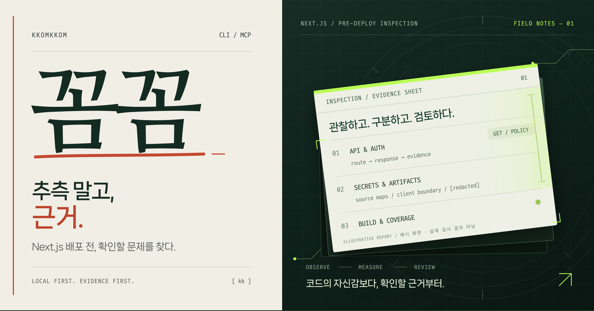
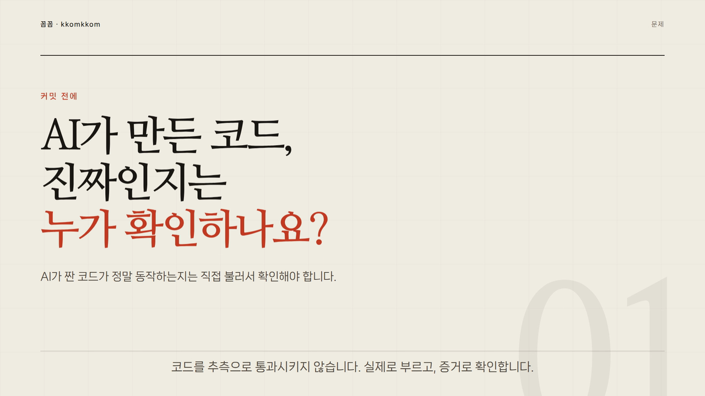

<div align="center">

<p>
  
</p>

<p>
  
</p>

# 🐯 꼼꼼 <sub>kkomkkom</sub>

**Next.js 앱의 인증·비밀정보·페이지 오류·JS 크기를 배포 전에 점검하는 CLI · MCP 도구.**

로컬에서 실행하고, 확인할 근거를 받으세요.

[](https://github.com/hodoi-ing/kkomkkom/actions/workflows/test.yml)
[](package.json)
[](LICENSE)

[빠른 시작](#빠른-시작) · [에이전트 연결](#에이전트-연결-mcp) · [검사 항목](#무엇을-검사하나요) · [지원·검증 상태](#지원검증-상태) · [English](#english)

</div>

<!-- DEMO_VIDEO: 85초 전체 기능 소개 영상 — GitHub는 저장소 내 MP4를 README에서 인라인 재생하지 않으므로 포스터 이미지 + MP4 링크로 제공합니다. 편집 기준: docs/demo.md -->

<p align="center">
  <a href="docs/assets/kkomkkom-intro-v3.mp4" title="85초 전체 기능 소개 영상 보기">
    
  </a>
  <br>
  <sub><a href="docs/assets/kkomkkom-intro-v3.mp4">85초 전체 기능 소개 영상 보기</a> (MP4 · 3.9MB · 소리 없음) · 화면은 예시 데이터입니다.</sub>
</p>


<p align="center"><sub>현재 보고서 렌더러에 고정된 예시 데이터를 넣어 생성한 화면입니다. 실제 앱 검사 녹화는 아닙니다.</sub></p>

**개발 중 · npm 미공개.** 현재는 저장소에 접근할 수 있는 사용자가 소스에서 빌드해 사용합니다. 검사 결과는 검토할 신호이며, 취약점이나 배포 안전 전체를 보증하지 않습니다.

## 빠른 시작

Node.js 20 이상과 의존성이 설치된 Next.js 프로젝트가 필요합니다. 아래 명령은 bash 환경(예: WSL Ubuntu) 기준입니다.

**1. 꼼꼼을 받아 빌드합니다.**

```bash
git clone https://github.com/hodoi-ing/kkomkkom.git
cd kkomkkom
npm ci
npm run build
```

**2. 검사할 Next.js 프로젝트 폴더에서 실행합니다.** 두 경로를 자신의 실제 경로로 바꾸세요.

```bash
cd /absolute/path/to/your-next-app
node /absolute/path/to/kkomkkom/dist/cli.js --fast --lang ko
```

`--fast`는 새 빌드와 JS 크기 측정을 생략합니다. HTTP·소스 검사는 실행하며, 필요한 경우 개발 서버를 시작합니다. 빌드까지 검사하려면 `--fast`를 빼세요. 일반 검사는 기준선을 저장하지 않습니다. 기준선 생성·교체는 `--update`를 붙였고 검사가 완전할 때만 일어납니다.

<details>
<summary>짧은 kkomkkom 명령으로 실행하기</summary>

빌드한 꼼꼼 저장소에서 `npm link`를 실행하면 이 컴퓨터에 CLI 명령이 연결됩니다. 이후 검사할 앱 폴더에서 실행하세요.

```bash
# 꼼꼼 저장소에서
npm link

# 검사할 Next.js 프로젝트에서
kkomkkom --fast --lang ko
```

현재 안내에서는 npm에 공개되지 않은 패키지를 `npx`로 받지 않습니다.

</details>

## 에이전트 연결 (MCP)

직접 명령을 실행하는 대신 에이전트가 같은 검사 엔진을 호출할 수 있습니다. 로컬에서 빌드한 stdio MCP 서버를 사용합니다.

아래는 `mcpServers` 형식을 사용하는 클라이언트의 설정 예시입니다. `args`의 파일 경로를 바꾸세요. 클라이언트마다 설정 위치와 형식이 다를 수 있습니다.

```json
{
  "mcpServers": {
    "kkomkkom": {
      "command": "node",
      "args": ["/absolute/path/to/kkomkkom/dist/mcp.js"]
    }
  }
}
```

도구 이름은 `kkomkkom`입니다. 호출 인자 예시:

```json
{
  "projectPath": "/absolute/path/to/your-next-app",
  "fast": true,
  "lang": "ko"
}
```

stdio에서 직접 호출하는 예시는 다음과 같습니다. 한 줄에 JSON-RPC 메시지 하나를 보냅니다.

```json
{"jsonrpc":"2.0","id":1,"method":"initialize","params":{"protocolVersion":"2024-11-05"}}
{"jsonrpc":"2.0","id":2,"method":"tools/call","params":{"name":"kkomkkom","arguments":{"projectPath":"/absolute/path/to/your-next-app","fast":true,"lang":"ko"}}}
```

`tools/call` 응답은 사람이 읽는 `content[0].text`와 CLI JSON과 같은 `structuredContent`(`schemaVersion: 2`, `coverage`, `diff`, `extra`, `exitCode`)를 함께 돌려줍니다. 도구 오류는 `isError: true`로 반환되며 스트림은 계속 사용할 수 있습니다. MCP에는 `--update`에 해당하는 인자가 없으므로 기준선 저장은 CLI에서만 합니다. `strict`, `reuse`도 받을 수 있지만 `reuse`는 실행 중인 서버가 같은 프로젝트인지 확인하지 않으며, 이 사실이 `coverage`에 `server`/`unsupported`로 남습니다. **OpenCode·Codex 등 에이전트별 실제 설치·연결·호출 검증은 보류 중**입니다. MCP 서버 제공과 각 에이전트의 호환성 검증 완료를 구분합니다. [재개 체크리스트 →](https://github.com/hodoi-ing/kkomkkom/issues/2)

## 무엇을 검사하나요?

| 검사 | 제공하는 근거 | 해석할 때 확인할 점 |
|---|---|---|
| **API 인증** | 쿠키·인증 헤더 없는 GET 응답과 소스의 인증 신호 | 공개 API의 200 응답만으로 취약점을 확정하지 않습니다. 간접 인증·미들웨어를 추가 확인하세요. |
| **비밀정보** | git에 추적된 루트 `.env*`, 하드코딩 키 패턴, 의심스러운 `NEXT_PUBLIC_` 이름 | 예제값·공개 설정은 구분해야 하며, 탐지·마스킹 범위에 한계가 있습니다. |
| **페이지 오류** | 페이지 GET에서 관찰한 오류·타임아웃 | 브라우저 렌더링·클릭·로그인 흐름을 검증하는 검사는 아닙니다. |
| **쓰기 API** | POST·PUT·PATCH·DELETE 소스의 인증 신호 | 쓰기 요청은 보내지 않습니다. 메서드별 AST 판정이 불가능한 wrapper·간접 호출은 미검증으로 남깁니다. |
| **JS 크기 증가** | 빌드 산출물의 라우트별 JS 청크 크기와 이전 기준선 비교 | 기본 경고 조건은 증가율 15% 이상 **그리고** 30,000바이트 이상. 압축 전 파일 크기이며 네트워크 전송량·TTFB와 다릅니다. |

`coverage.status`가 `incomplete`이면 일부 검사가 실패(`failed`)했거나 해석할 수 없었습니다(`unsupported`). `empty`는 의미 있는 검사가 하나도 실행되지 않았다는 뜻이며 통과가 아닙니다. 일반 실행은 이런 상태에서도 종료 코드 0일 수 있지만, `--strict`는 종료 코드 1로 처리합니다. 페이지 소스가 발견됐는데 빌드 결과에 그 페이지의 측정값이 없으면 부분 측정으로 보고 `--update`를 거부합니다.

### 배포물 정적 검사 (`--artifacts`)

`--artifacts`는 개발 서버·빌드·AI CLI·의존성 설치 없이 `public/`과 `.next/static/`의 배포물을 검사합니다. 설정·`BUILD_ID`·소스 import 그래프·루트 `.env*`도 제한된 범위에서 읽어 지원 여부와 마스킹·비교 근거로 사용합니다. 기존 `--fast`의 의미는 바뀌지 않습니다. 새 빌드가 필요하면 `--artifacts --fresh`처럼 빌드를 명시해야 하며, 이때만 `next build`가 실행됩니다. MCP에서는 `artifacts: true`, 빌드까지 하려면 `artifacts: true`와 `fresh: true`를 함께 보냅니다.

| rule ID | 확인하는 것 | 한계 |
|---|---|---|
| `artifact-source-map` | 제공 경계 안의 유효한 `.map` 파일, 실제 소스맵 주석의 `sourceMappingURL` 참조, 유효한 inline map, `productionBrowserSourceMaps: true` 설정 | 설정만으로 실제 공개를 확정하지 않으며, 설정과 산출물은 별도 근거입니다. `.next/server`의 map은 공개 산출물로 보지 않습니다. 파일명만 있는 `.map`, 잘못된 JSON·data URL, 문자열 속 가짜 신호는 확정하지 않고 `static-only`/`unsupported`로 남깁니다. |
| `artifact-sensitive-file` | 제공 경계 안의 `.env`, 백업·로그·DB·키·테스트·압축 파일 | 파일명만으로 확정하지 않고, 읽을 수 있으면 비밀값 패턴을 추가 확인합니다. 저장소에만 있는 테스트 파일은 경고하지 않습니다. |
| `artifact-client-secret` | 클라이언트 제공 파일의 고신뢰 provider 키 패턴, 알려진 서버 env 값의 실제 일치, `NEXT_PUBLIC_*` 의심 이름 | provider 키 패턴은 `critical`이며, 루트 `.env*`의 민감한 비공개 키 값이 일치하면 `warning`/`confidence: uncertain`으로 키 이름·파일 위치만 보고합니다. 값 자체는 출력하지 않습니다. 공개 `NEXT_PUBLIC_*` 값, 일반 버전·URL 설정, 예제·placeholder는 env에 있다는 이유만으로 비밀로 분류하지 않습니다. 이름 신호도 `uncertain`입니다. |
| `artifact-server-boundary` | `use client`에서 출발한 상대 경로 정적 import가 `server-only` 또는 제한된 서버 전용 runtime import에 닿는 근거 | 배포 유출 확정이 아니라 서버 경계 혼입 가능성입니다. 타입 전용 import/export는 제외합니다. 별칭·동적 import·해석 실패·프로젝트 루트 밖 경로는 `unsupported`로 남기고 안전/위험을 추정하지 않습니다. 목록 밖의 외부 라이브러리 import는 오류로 만들지 않습니다. |

서버 runtime import 목록은 `pg`, `mysql2`, `@prisma/client`, `firebase-admin`, `fs`/`node:fs`, `child_process`/`node:child_process`, `net`/`node:net`, `@clerk/nextjs/server`, 그리고 `next-auth`의 `getServerSession`입니다. React·클라이언트 인증 import 자체는 이 근거가 아닙니다. 모듈 상단의 `use server`에서는 그래프 추적을 멈추고 `static-only/server-action-boundary`로 기록합니다. 함수 안의 같은 문자열은 모듈 경계가 아니며, `use client`와 `use server`가 함께 있으면 `unsupported/conflicting-directives`입니다. 동적 env 키(`process.env[key]`)는 `unsupported/process-env-dynamic`으로 남겨 미검증임을 표시합니다.

배포물 탐색은 기본 Next 출력인 `public/`과 `.next/static/`으로 제한합니다. `next.config.*`는 실행·import하지 않고 텍스트만 읽습니다. `distDir` 변경, `output: "export"`, `output: "standalone"`, 복수 설정, 정적으로 해석할 수 없는 설정은 지원 성공으로 표시하지 않고 `unsupported` coverage로 남깁니다. `.next` 존재만으로 최신 빌드라고 단정하지 않으며, 빌드하지 않은 검사는 `build-freshness-unknown`을 기록합니다. 파일당 1 MiB, 전체 32 MiB, 2000개 상한을 넘거나 읽기 실패가 있으면 `failed`, symlink 경계 이탈이나 해석 불가는 `unsupported` coverage로 남기고 통과로 숨기지 않습니다. 별도 로더가 검증하는 `kkomkkom.config.json`은 최대 1 MiB이며, 파일이 없거나 작아도 전체 예산에서 1 MiB와 1개를 보수적으로 예약합니다. 나머지 읽기는 최대 31 MiB·1999개를 공유합니다.

`artifactExceptions`는 정확히 같은 rule ID와 프로젝트 상대 파일에만 적용됩니다. 사유가 비어 있거나 알 수 없는 rule ID, 절대 경로, `..` 경로는 설정 오류(exit 2)입니다. 예외로 억제된 항목은 `coverage.checks[]`에 `ignored`와 사유로 남습니다. 예외의 정확한 경로 매칭은 마스킹 전에 수행하며, 결과의 경로·id·메시지·coverage에는 알려진 env 값과 provider 키 패턴을 가립니다. 같은 표시 경로로 가려진 관찰도 합치지 않습니다.

### 명시적 로컬 production HTTP 확인

운영 빌드와 서버는 사용자가 별도로 준비합니다. `--artifacts --production-url http://127.0.0.1:3000`은 이미 실행 중인 로컬 서버에만 GET을 보냅니다. MCP에서는 `artifacts: true, productionUrl: "http://127.0.0.1:3000"`을 전달합니다. 이 옵션은 서버를 시작하거나 설정·기준선을 쓰지 않습니다. `--fresh`를 함께 지정할 때만 먼저 빌드하므로, 실행 중인 서버가 그 빌드를 제공하는지도 따로 확인하세요.

허용 주소는 경로 없는 정규 HTTP loopback origin(`localhost`, `127.x.x.x`, `[::1]`)입니다. `localhost`는 DNS 조회 없이 `127.0.0.1`로 바꿉니다. 인증정보·쿼리·fragment·비 HTTP·외부 호스트·축약/비정규 IP는 거부합니다. 쿠키·Authorization·쓰기 요청은 보내지 않고 redirect도 따라가지 않습니다.

검증된 `public/`·`.next/static/` 실파일만 후보가 되며, 경로 세그먼트를 인코딩하고 URL 중복을 제거합니다. 완전한 2xx 응답 본문이 파일의 raw bytes와 같을 때만 그 파일의 `local-production-http` 관찰을 추가합니다. JS 파일의 일치는 참조된 map의 제공을 증명하지 않습니다. SPA fallback·redirect·404·잘린 본문·일치하는 prefix만 있는 응답은 미확인으로 남기고, 기존 정적 finding은 지우지 않습니다. 서버의 프로젝트 신원과 인터넷 노출은 여전히 미확인입니다. 후보가 없으면 파일 검증을 수행하지 않았다고 표시합니다.

HTTP 상한은 URL 50개, 동시 5개, 요청당 본문 완료까지 5초, 전체 60초, 본문당 1 MiB, 합계 32 MiB입니다. 합계는 처리에 수락한 payload 바이트 예산이며 네트워크·OS 버퍼 크기를 보장하는 값은 아닙니다. 초과 chunk는 보관하지 않고 stream을 취소합니다. 이 예산은 로컬 읽기 예산과 별개이며, 제한·오류·남은 미검증 파일은 coverage에 기록됩니다. 본문과 비밀값이 담긴 digest는 출력하지 않습니다.

### 제한된 소스맵 설정 보호 (`--protect-sourcemaps`)

일반 검사와 MCP는 설정을 고치지 않습니다. 보호 명령도 기본은 미리보기입니다. 프로젝트 루트에서 아래 순서로 실행합니다.

```bash
kkomkkom --protect-sourcemaps --lang ko
# 표시된 파일·token 위치·영향을 검토한 뒤, 출력된 hash를 그대로 사용합니다.
kkomkkom --protect-sourcemaps --apply --expected-hash HASH --lang ko
# 적용 결과에 표시된 transaction ID로 설정만 복원합니다.
kkomkkom --restore TRANSACTION_ID --lang ko
```

- 대상은 **하나의** `next.config.js/mjs/cjs/ts`에서 직접 객체로 내보낸 `productionBrowserSourceMaps: true`입니다. AST로 찾은 `true` token만 `false`로 교체합니다. 속성이 없거나 이미 `false`면 미리보기는 no-op입니다. wrapper·변수 간접 export·복수 설정/export·spread·computed/중복 속성·그 밖의 최상위 실행문은 미지원으로 끝납니다. 설정 코드를 실행해 미리보기를 만들지 않습니다.
- 미리보기에는 상대 파일명, token과 위치, 승인용 원본 SHA-256만 표시합니다. 주변 설정이나 `.env` 내용은 출력하지 않습니다. hash는 명시적 적용 승인용이며 비밀 노출의 증거가 아닙니다.
- 적용에는 Git에 추적된 **설정 파일의 HEAD/index/worktree가 모두 같은 상태**와 미리보기 hash가 필요합니다. `core.filemode=true`이면 blob뿐 아니라 실행 권한도 비교해 assume-unchanged/skip-worktree로 숨겨진 chmod를 거부합니다(`core.filemode=false`는 존중). Git 없음·untracked·staged/unstaged 변경·경로 symlink·경쟁 transaction은 거부합니다. 다른 파일의 변경을 커밋하거나 되돌리지 않습니다. `--apply`만 쓰거나 hash만 주면 적용되지 않으며, CI도 대화형 승인을 기다리지 않습니다.
- 원본 바이트와 mode를 private `.kkomkkom/protection/TRANSACTION_ID/`에 먼저 보존·동기화하고 설정을 원자적으로 교체합니다. 백업에는 인증정보·비밀값이 포함될 수 있습니다. 백업 저장 전에 새 transaction 내부에 `.gitignore`(`*`)를 생성·동기화해 백업과 metadata를 일반 `git add -A`에서 제외합니다. 기존 프로젝트 `.gitignore`나 전역 설정은 변경하지 않습니다. 강제 추가(`git add -f`)나 공유는 하지 마세요. 자동 stale-lock 삭제는 없습니다. 강제 종료 뒤 lock/active가 남으면 실행 중인 작업과 transaction을 먼저 확인해야 합니다.
- 적용 후 **설치된 로컬 Next**로 production 빌드 → 새로 소유한 `127.0.0.1` 서버 smoke → 배포물·HTTP 검사를 실행하고 서버를 정리합니다. 기존 dev 서버를 재사용하지 않습니다. 빌드 실패, 불완전한 검사, 남은 소스맵/소스맵 예외, critical 배포물 finding은 검증 실패입니다. 의존성을 추가하거나 자동 설치·다운로드하지 않지만, 프로젝트의 빌드 코드는 실행되므로 자체 네트워크·파일 부작용이 있을 수 있습니다.
- 실패하면 현재 hash와 mode가 적용본과 같을 때만 설정 복원을 시도합니다. `verification`, `rollback`, `rollbackFailureReason`, `configChanged`를 따로 확인하세요. 사용자 후속 수정·손상된 백업·변조된 metadata·이전 transaction은 덮어쓰기로 해결하지 않습니다. SIGINT/SIGTERM도 소유 프로세스 정리와 안전한 복원 시도 후 각각 130/143으로 종료합니다. SIGKILL·전원 차단에서는 정리 완료를 보장할 수 없습니다.
- 소유 lock 정리는 서버 정리(`verification.cleanup`)와 별도인 `lockCleanup`으로 보고합니다. `passed`만 삭제 완료이며, 삭제 실패는 `failed`, 교체·읽기 실패 등 소유권 미확인은 `unconfirmed`입니다. 정리가 확인되지 않으면 exit 1이며 기존 작업 결과·transaction·검증·복원 정보는 유지합니다. 성공한 작업도 이 경우 `status: lock-cleanup-failed`와 원래 `operationStatus`를 표시합니다. 남은 lock 때문에 복원이 거부될 수 있으므로 소유자와 transaction부터 확인하세요. 자동 권한 변경·강제 삭제는 하지 않습니다.

**복원되는 것은 설정뿐입니다.** 생성된 `.next` 등 빌드 산출물은 되돌리지 않습니다. 설정을 복원한 뒤 필요하면 다시 빌드하세요. 브라우저 소스맵을 줄이면 오류 추적 정보도 줄어들 수 있으며, 서버 비밀 보호·역분석 방지·배포 안전 보장은 아닙니다. 민감 파일이나 기존 map을 직접 삭제하지 않습니다.

보호 모드는 `--json`, `--lang`만 함께 쓸 수 있습니다. `--restore`는 preview/apply와 별도 모드이며, 검사·AI 설명·`--update`·`--reuse`·포트 옵션과 조합할 수 없습니다. MCP에는 보호 도구가 없고 보호 인자도 거부합니다. 보호 JSON은 일반 검사 schemaVersion 2 보고서가 아닌 작업 결과입니다. Linux/WSL 임시 Git 프로젝트와 실제 Next/packed CLI에서 검증했으며 Windows/macOS는 미검증입니다. 파일 최종 확인과 rename 사이의 짧은 구간은 같은 권한의 외부 프로세스까지 잠그는 OS transaction이 아닙니다.

### 결과를 보고 무엇을 하나요?

1. 보고서에 나온 경로·파일과 관찰 내용을 확인합니다.
2. 공개하도록 만든 API인지, 인증이나 미들웨어가 실제로 적용되는지 확인합니다.
3. 필요한 수정을 한 뒤 같은 조건으로 다시 검사합니다.

보고서의 `exposed`나 “뚫린 문” 표현도 현재 탐지 규칙의 판정입니다. 실제 권한 우회 여부는 별도 확인해야 합니다. [정확도·오류 처리 개선 항목 →](https://github.com/hodoi-ing/kkomkkom/issues/1)

## 자주 쓰는 명령

아래는 `npm link`로 명령을 연결한 경우입니다. 연결하지 않았다면 `kkomkkom`을 `node /absolute/path/to/kkomkkom/dist/cli.js`로 바꾸세요.

```bash
kkomkkom --fast --lang ko   # 새 빌드 없이 검사
kkomkkom --lang ko          # 빌드·JS 크기 비교 포함
kkomkkom --json             # JSON 보고서
kkomkkom --strict           # 경고도 종료 코드 1로 처리
kkomkkom --reuse --port 3100 # 실행 중인 Next 서버 사용
kkomkkom --explain          # 설치된 AI CLI로 추가 설명 요청
```

`--reuse`는 같은 프로젝트의 서버인지 확인하지 않습니다. `--explain`은 설치된 AI CLI를 사용하며, 해당 CLI 설정에 따라 외부 모델로 데이터가 전달될 수 있습니다.

<details>
<summary>전체 옵션과 종료 코드</summary>

| 옵션 | 동작 |
|---|---|
| `--fast` | 새 빌드·새 JS 크기 측정을 생략. HTTP·소스 검사는 실행 |
| `--artifacts` | `public/`·`.next/static/` 정적 배포물만 검사. 서버·빌드·설치 없음 |
| `--artifacts --fresh` | 먼저 `next build`를 실행한 뒤 새 배포물 검사 |
| `--artifacts --production-url URL` | 실행 중인 HTTP loopback 서버에 GET으로 파일 바이트 일치 확인. 자동 서버 시작 없음 |
| `--protect-sourcemaps` | 설정 token 변경 미리보기만 실행 |
| `--protect-sourcemaps --apply --expected-hash HASH` | 명시 적용 후 production 빌드·소유 서버·배포물 검증. 실패 시 안전한 설정 복원 시도 |
| `--restore TRANSACTION_ID` | 활성 transaction의 적용 hash/mode가 일치할 때만 원본 설정 복원 |
| `--json` | 일반 검사: `schemaVersion: 2`, `coverage`, `diff`, `extra`, `exitCode`. 보호: status·transaction·검증/복원 작업 결과 |
| `--strict` | warning 또는 `coverage` 불완전/빈 범위를 종료 코드 1로 처리 |
| `--port 3100` | 개발 서버 포트 지정. 기본값은 `kkomkkom.config.json`의 `port` 또는 3100 |
| `--reuse` | 지정 포트에서 실행 중인 Next 서버 재사용. 같은 프로젝트인지 확인하지 않음 |
| `--lang ko` | 보고서 언어: `en`, `ko`, `ja`, `zh`, `es` |
| `--explain` | `claude`, `codex`, `gemini` 순으로 설치된 AI CLI 탐색 |
| `--explain-with codex` | 설명에 사용할 AI CLI 우선 지정 (`--explain`과 함께 사용) |
| `--update` | 완료된 검사 결과를 기준선으로 저장. 빠른 검사는 기존 페이지 크기를 유지하고, 일반 검사는 새 측정값을 저장 |
| `--help`, `--version` | 사용법·버전 표시 |

언어 적용 순서: `--lang` → `KKOMKKOM_LANG` → `LC_ALL` → `LANG`.

| 종료 코드 | 현재 동작 |
|---|---|
| `0` | 현재 규칙상 실행을 막는 결과가 없음. 기본 모드의 warning이나 일부 미검증 결과도 포함될 수 있음 |
| `1` | API `exposed`, critical 항목, 빌드 실패, 또는 `--strict`의 warning·불완전/빈 coverage |
| `2` | 프로젝트·포트·설정·기준선 오류로 검사를 시작·완료하지 못했거나, 기준선 갱신이 거부됨 |

`unknown` 판정이나 `failed`/`unsupported` coverage는 기본 실행에서 exit 0일 수 있지만, `--strict`에서는 1입니다. 400·408·429처럼 GET 인증을 확인하지 못한 응답은 `checked`가 아니라 `api-auth` `failed`/`http-<status>`로 남습니다. 종료 코드 0과 “배포해도 좋습니다” 문구를 전체 검증 완료로 해석하지 마세요. 관련 동작은 [#1](https://github.com/hodoi-ing/kkomkkom/issues/1)에서 추적합니다.

</details>

<details>
<summary>설정과 기준선</summary>

검사할 프로젝트 루트에 `kkomkkom.config.json`을 둡니다.

```json
{
  "ignoreRoutes": ["/api/health", "/api/webhooks/*"],
  "sampleParams": { "/api/orders/[id]": { "id": "1" } },
  "routePolicies": { "/api/webhooks/stripe": { "POST": "public" } },
  "artifactExceptions": [
    { "ruleId": "artifact-source-map", "file": "public/demo.js.map", "reason": "공개 데모 파일" }
  ],
  "port": 3100,
  "thresholds": { "jsPercent": 15, "jsBytes": 30000 }
}
```

| 설정 | 용도 |
|---|---|
| `ignoreRoutes` | 검사에서 제외할 경로. 공개 API인지 확인한 뒤 지정 |
| `sampleParams` | 동적 라우트에 넣을 테스트 값. 값이 없으면 해당 동적 API의 HTTP 검사는 생략 |
| `routePolicies` | 라우트·메서드별 `public`/`protected` 명시. 명시 `protected`인데 로그인 없이 2xx면 `exposed` |
| `port` | 개발 서버 포트. 기본 3100. `--port`가 우선 |
| `thresholds` | JS 크기 증가의 경고 기준. 두 조건을 모두 충족해야 경고 |
| `artifactExceptions` | 정확한 rule ID·프로젝트 상대 파일의 배포물 결과만 억제. 사유 필수, coverage에 `ignored`로 표시 |

기준선은 `.kkomkkom/baseline.json`에 저장됩니다. 예시 구조:

```json
{
  "version": 1,
  "createdAt": "2026-10-22T00:00:00.000Z",
  "routes": { "/api/secret": { "verdict": "locked" } },
  "pages": { "/checkout": { "firstLoadJs": 180000, "method": "manifest-file" } }
}
```

**저장 시점.** 일반 검사는 기준선을 읽기만 합니다. 생성·교체는 `--update`를 명시했고 `coverage.status`가 `complete`일 때만 일어납니다. 빌드 실패, 측정 실패, 필수 검사 누락, 빈 범위에서는 갱신을 거부하고 기존 파일을 바이트 그대로 둡니다. 저장은 `.kkomkkom/baseline.json.lock` 아래 고유 임시 파일 작성 후 rename으로 교체합니다.

**lock.** 다른 프로세스가 lock을 잡고 있으면 최대 5초 기다린 뒤 명시적 오류로 끝냅니다. mtime만 보고 오래된 lock을 자동 삭제하지 않습니다. 실행 중인 꼼꼼 프로세스가 없다고 확인한 경우에만 `.kkomkkom/baseline.json.lock`을 직접 지우세요. 꼼꼼은 자신이 만든 lock만 해제합니다.

**측정 방식과 비교.** `manifest-file`은 `.next` 빌드 매니페스트가 참조하는 고유 JS 청크 파일 크기의 합(비압축 파일 기준)입니다. 매니페스트가 없는 구버전 출력의 `next-output`은 해당 Next 버전이 `Size`/`First Load JS` 표에 보고한 값을 파싱한 것으로, 비압축 파일 합계나 실제 HTTP 전송량과 같다고 보장하지 않습니다. 두 방식 모두 gzip 전송량·TTFB·브라우저 성능과 다릅니다. 측정 방식이 기준선과 현재 검사에서 모두 기록되어 있고 같을 때만 증감·경고를 계산합니다. `method`가 없는 구버전 기준선은 읽되 페이지 크기를 비교하지 않고, `--update`로 새 측정값을 저장하기 전까지 마이그레이션 안내를 표시합니다. 페이지 소스가 발견됐는데 해당 페이지의 측정값이 없으면 0으로 대체하지 않고 `build` coverage `failed`로 남깁니다.

**JSON schema.** CLI `--json`과 MCP `structuredContent`는 `schemaVersion: 2`이며 `coverage`, `diff`, `extra`, `exitCode`를 공유합니다. `coverage.checks[]`의 `status`는 `checked`, `static-only`, `ignored`, `skipped`, `failed`, `unsupported` 중 하나이고 `reason`에 근거가 붙습니다. `coverage.status`는 `complete`, `incomplete`, `empty`입니다. `--reuse`는 실행 중인 서버가 같은 프로젝트인지 확인하지 않으므로 `server`/`unsupported` 검사가 추가됩니다.

</details>

<details>
<summary>CI에서 실행하기</summary>

현재는 npm 배포판 대신 빌드한 로컬 CLI를 사용합니다. 다음은 워크플로의 **단계 예시**이며, 두 저장소 체크아웃·의존성 설치·꼼꼼 빌드를 먼저 구성해야 합니다. 두 경로를 러너의 실제 경로로 바꾸세요.

```yaml
- name: Run kkomkkom
  working-directory: /absolute/path/to/your-next-app
  run: node /absolute/path/to/kkomkkom/dist/cli.js --fast --strict --lang ko
```

비공개 저장소를 가져오는 접근 권한도 필요합니다. `--fast`에서는 새 빌드·JS 크기를 검증하지 않으므로, 페이지 무게까지 CI에서 막으려면 `--fast`를 빼고 `--strict`를 함께 쓰세요. `--strict`는 warning과 불완전한 coverage를 모두 exit 1로 처리합니다.

</details>

## 실행 범위와 데이터 처리

- HTTP 검사는 `127.0.0.1`에 **GET만** 보내며 쿠키·인증 헤더를 넣지 않습니다. GET 핸들러에 부수효과가 있는 앱은 개발용 데이터로 검사하세요.
- 직접 시작한 개발 서버만 종료합니다. 개발 서버는 `--hostname 127.0.0.1`로 바인딩합니다. `--reuse`에서 재사용한 서버는 종료하지 않으며, 같은 프로젝트인지 확인하지 않습니다.
- 소스·설정을 자동 수정하는 기능은 없습니다. 개발 서버·빌드가 `.next` 같은 생성물을 만들고, `--update`가 기준선과 lock·임시 파일을 만들 수 있습니다. 일반 검사는 기준선을 수정하지 않습니다.
- 보고서·JSON·AI 설명용 프롬프트·빌드 오류 로그에 탐지 범위 내 비밀값을 `[redacted]`로 가립니다. 모든 비밀값의 제거를 보장하지 않습니다.
- `--explain`은 선택 기능입니다. 기본 검사는 AI 계정 없이 실행되지만, Next 도구 실행과 의존성 준비 과정에는 별도 설치·네트워크 사용이 필요할 수 있습니다.

## 지원·검증 상태

| 항목 | 현재 상태 |
|---|---|
| 프레임워크 | Next.js 대상. 다른 프레임워크 지원은 제공하지 않음 |
| 실행 방식 | CLI와 로컬 stdio MCP 서버 제공 |
| 자동 검증 구성 | GitHub Actions에 Node 20·22·24 단위 테스트와 실제 Next fixture e2e 구성. 실행 결과는 상단 Tests 배지에서 확인 |
| production·pack 검증 | 2026-10-22 Linux/WSL에서 실제 `next build`(비 fast), 매니페스트 측정, MCP `tools/call`, npm pack 소비자 CLI/MCP를 확인. 상세 로그는 [검증 기록](docs/verification-2026-10-22.md) |
| 배포물·로컬 production HTTP 검사 | `--artifacts`/MCP `artifacts`, opt-in `production-url`/`productionUrl`. Linux/WSL 임시 production fixture와 packed consumer CLI/MCP 연결 검증(2026-10-22). 외부 배포·CDN·프로젝트 신원은 미검증 |
| 플랫폼 | Linux/WSL에서만 검증. **Windows·macOS는 미검증** |
| 에이전트별 검증 | **보류**. OpenCode·Codex 등 개별 클라이언트 호환성 완료를 보장하지 않음 |
| 배포 | npm 미공개. 저장소 접근 권한과 로컬 빌드 필요 |
| 제한된 설정 보호 | 단일 직접 source-map 설정의 preview/명시 apply/hash-safe restore 구현·Linux/WSL 로컬 검증·총괄 독립검수·PR #3/main CI 완료(2026-10-23). Windows/macOS는 미검증. 일반 앱 변환·난독화는 미지원 |

### 현재 한계

- 인증·쓰기 API 판정은 가벼운 소스 분석이라 문자열·간접 호출·메서드별 인증을 잘못 해석할 수 있습니다.
- 비밀정보 검사는 루트 `.env*`와 주요 소스 폴더 중심이며, 하위 `.env`와 모든 셸 환경변수를 다루지 않습니다. `NEXT_PUBLIC_`는 이름 기반 신호입니다.
- 개발 서버 HTTP 결과는 production 배포 검증과 다릅니다. 페이지 타임아웃·검사 생략·지원하지 않는 빌드 형식도 확인해야 합니다.
- JS 크기는 압축 전 파일 크기 합이라 gzip·네트워크 전송량·TTFB와 다릅니다. 페이지 측정값이 하나라도 빠지면 불완전으로 처리하며 0으로 채우지 않습니다.
- 실제 production 빌드·pack 소비자·MCP 호출 검증은 Linux/WSL에서 수행했습니다. Windows·macOS의 프로세스 종료, 경로, `npm pack` 설치는 미검증입니다.
- `--artifacts`만 실행하면 실제 HTTP 제공은 확인하지 않습니다. 명시적 `--production-url`도 선택한 로컬 파일의 응답 바이트만 확인하며, CDN·프록시·외부 배포·서버 프로젝트 신원은 확인하지 않습니다. custom `distDir`, `export`, standalone, 모노레포 출력은 미지원이며 빌드 신선도는 명시 빌드 없이는 `unknown`입니다. 파일명 신호와 실제 비밀값, 소스맵 설정과 공개 노출을 구분해 읽어야 합니다.

[정확도·오류 처리 개선 #1](https://github.com/hodoi-ing/kkomkkom/issues/1) · [제품 로드맵·검증 재개 체크리스트 #2](https://github.com/hodoi-ing/kkomkkom/issues/2)

## 개발과 참여

```bash
npm ci
npm test          # 단위 테스트만 필요할 때. verify와 중복 실행할 필요 없음
```

실제 Next fixture와 packed consumer까지 검증하려면 다음 준비를 명시적으로 수행합니다(Bash 기준). 준비 단계에서는 npm registry 접근이 필요할 수 있습니다. `verify` 자체는 fixture에 자동 설치하지 않으며, 임시 packed consumer는 준비된 캐시만 `--offline`으로 사용합니다.

```bash
npm ci --prefix fixtures/mini-app --no-audit --no-fund
npm cache add "typescript@$(node -p "require('./package.json').dependencies.typescript")"
npm run verify    # 빌드 + 단위 테스트 + 실제 Next fixture + packed CLI/MCP
# 개발 중 보호 통합만 확인할 때 (전체 회귀는 최종 verify에 포함)
node scripts/verify.mjs --protect-only
```

root `npm ci`가 lockfile의 tarball을 캐시했더라도, 소비자 설치가 runtime range를 해석할 registry 메타데이터까지 있다고 보장하지 않습니다. `npm cache add`는 현재 runtime 의존성인 TypeScript의 range 메타데이터와 선택된 tarball을 함께 준비합니다. 캐시 부족을 숨기는 `prefer-offline` 네트워크 폴백은 사용하지 않습니다.

오탐·누락을 발견했다면 실제 비밀값을 제거한 최소 예제와 명령, 예상 결과, 실제 결과를 [이슈](https://github.com/hodoi-ing/kkomkkom/issues)에 남겨주세요.

[데모 영상 편집·삽입 가이드](docs/demo.md) · [MIT 라이선스](LICENSE)

<a id="english"></a>
<details>
<summary><b>English</b></summary>

**kkomkkom** is a local CLI and stdio MCP tool for checking Next.js apps before a commit or deployment. It combines unauthenticated HTTP GET probes, source-based auth and secret signals, page error checks, and JS size comparisons against a saved baseline.

The package is not published to npm. Clone an accessible copy of this repository, run `npm ci` and `npm run build`, then run `node /absolute/path/to/kkomkkom/dist/cli.js --fast` from your Next.js app. Replace the absolute path with your local checkout. Remove `--fast` to build and measure JS size. A normal check never writes the baseline; pass `--update` to save a complete result. Incomplete coverage, build failures and missing page measurements are refused, and the existing baseline stays byte-identical.

For repository e2e verification, explicitly run `npm ci --prefix fixtures/mini-app --no-audit --no-fund`, then the `npm cache add` command in the development section before `npm run verify`. These preparation steps may use the registry. Root `npm ci` alone can leave a tarball-only cache without runtime-range metadata. Verification never installs into the fixture, and its temporary packed consumer uses `--offline` with no network fallback; cache priming covers the current TypeScript runtime range and the selected tarball.

For MCP, launch `node /absolute/path/to/kkomkkom/dist/mcp.js`. The tool is named `kkomkkom`; pass the app's absolute `projectPath`. A `tools/call` response includes readable text plus `structuredContent` with `schemaVersion: 2`, `coverage`, `diff`, `extra` and `exitCode`. Tool errors set `isError` and keep the stream usable. There is no MCP update argument, so baseline writes stay a CLI operation. `reuse` does not verify that the running server belongs to the project and records `server`/`unsupported` coverage. Individual agent connection tests are deferred, not completed.

`--artifacts` (MCP `artifacts: true`) is a standalone static check of `public/` and `.next/static/`. It also reads bounded config, `BUILD_ID`, source import graphs and root `.env*` files for support detection, masking and value matching. It does not start a server, build, call an AI CLI or install packages. `--fresh` (MCP `fresh: true`) is the only way to make it build first. Stable rule IDs are `artifact-source-map`, `artifact-sensitive-file`, `artifact-client-secret` and `artifact-server-boundary`. Next config is never executed; `.next/server` maps are not treated as public. Unsupported output, missing artifacts, read failures, symlink escapes and budget limits stay visible as `unsupported`/`failed` coverage. `artifactExceptions` must name a known rule, a project-relative file and a nonempty reason; suppressed findings stay visible as `ignored` coverage. Actual HTTP serving is not verified in this mode.

For `artifact-client-secret`, high-confidence provider-key patterns are `critical`. A literal match in a client artifact to a known sensitive, non-public server env value is instead a `warning` with `confidence: uncertain`: only the key name and file location are reported, never the value. Public `NEXT_PUBLIC_*` values, ordinary version/URL settings and examples/placeholders are not private merely because they appear in an env file. Name-only signals remain uncertain.

`artifact-server-boundary` follows relative static imports from `use client` entries to `server-only` markers or these runtime imports: `pg`, `mysql2`, `@prisma/client`, `firebase-admin`, `fs`/`node:fs`, `child_process`/`node:child_process`, `net`/`node:net`, `@clerk/nextjs/server`, and `getServerSession` from `next-auth`. This is potential boundary misuse, not proof of a deployed leak. Type-only imports/exports and React/client-auth imports are not runtime server evidence. A module-level `use server` directive stops traversal with `static-only/server-action-boundary`; a function-local string does not. Conflicting `use client`/`use server` directives are `unsupported/conflicting-directives`. Aliases, dynamic imports and unresolved graphs stay unverified; dynamic env keys such as `process.env[key]` are `unsupported/process-env-dynamic`.

Reads are limited to 1 MiB per file, 32 MiB total and 2000 entries. The separately validated `kkomkkom.config.json` loader allows at most 1 MiB; the scan conservatively reserves that maximum and one entry even if the config is absent or smaller. All remaining reads share at most 31 MiB and 1999 entries.

To verify an already-running local production server, use `--artifacts --production-url http://127.0.0.1:3000`, or MCP `artifacts: true, productionUrl: "http://127.0.0.1:3000"`. This never starts a server or writes config/baselines; only explicit `--fresh` builds first. Accepted origins are canonical HTTP `localhost`, `127.x.x.x` or `[::1]`, without credentials, path, query or fragment. Localhost is normalized to numeric loopback without DNS. No cookies, Authorization, write methods or redirect following.

Only verified served-boundary files become candidates, with encoded path segments and URL deduplication. A complete 2xx payload must exactly match the file's raw bytes for a `local-production-http` observation. Matching a JS file does not verify its referenced map. SPA fallbacks, redirects, 404s, cut-off bodies and matching prefixes stay unconfirmed; static findings remain. Server/project identity and Internet exposure are unverified, and zero candidates explicitly means no file verification ran.

HTTP limits are 50 URLs, five concurrent requests, five seconds through body completion per request, 60 seconds overall, 1 MiB per body and 32 MiB accepted payload in total, separate from local reads. Excess chunks are rejected and streams cancelled. This is not a bound on network/OS buffering or a download-byte measurement. Limits/errors/unverified targets remain coverage. Contents and secret-bearing digests are never emitted. Known env values and provider patterns are also masked in output IDs, file paths, messages and coverage after raw candidate/exception matching; distinct redacted observations remain separate.

Page weights are not raw network sizes. `manifest-file` is the sum of uncompressed JS chunk files referenced by the build manifests. `next-output` is the `First Load JS` value reported by that older Next version, which is not guaranteed to equal either the raw file sum or the actual HTTP transfer size. Neither method is gzip transfer size or TTFB. Sizes are compared only when both runs recorded the same method; legacy baselines without one are loaded but not compared until a non-fast `--update` replaces their values. Production-build, packed-consumer and local MCP calls were verified on Linux/WSL only; Windows and macOS are untested.

`--protect-sourcemaps` is a separate, preview-only action. It accepts exactly one direct object export in `next.config.js/mjs/cjs/ts` and locates only the literal `productionBrowserSourceMaps: true` token. Absent/false is a preview no-op; wrappers, indirect exports, multiple configs/exports, executable top-level statements, spread/computed/duplicate properties and parser errors are unsupported. Preview never evaluates config and shows only the relative filename, token/location and SHA-256 approval token, not adjacent config/env values.

Apply requires `--protect-sourcemaps --apply --expected-hash HASH` and a tracked target whose HEAD, index and raw worktree match. No interactive CI approval, implicit apply, Git reset or dependency installation. The tool rejects unsafe/symlinked paths and competing transactions, saves a private byte-exact durable backup, preserves mode and atomically replaces only that token. The lock spans build and verification. It then runs the installed Next production build, a newly owned `127.0.0.1` production server, and artifact/HTTP inspection; it never reuses a dev server. Build errors, incomplete coverage, residual/suppressed source maps and critical artifact findings fail verification. Project build code may still perform its own network/file operations.

With `core.filemode=true`, the clean guard also compares HEAD/index/worktree executable mode, including changes hidden by assume-unchanged/skip-worktree; `core.filemode=false` is respected. Lock removal is reported separately from server cleanup: `lockCleanup: passed` confirms removal, `failed` means removal failed, and `unconfirmed` means ownership could not be verified (for example a replaced or unreadable lock). Unresolved cleanup exits 1 while preserving transaction, verification and rollback details. An otherwise successful operation becomes `status: lock-cleanup-failed` with its original `operationStatus`. A remaining lock can block restore; inspect ownership and the transaction rather than force-delete, auto-chmod or stale-lock cleanup.

`--restore TRANSACTION_ID` is a separate mode and only restores the active owned transaction when current content hash and mode still match the applied file. Later edits, corrupt backups and malicious metadata are refused. Verification failures attempt the same config-only rollback; inspect `verification`, `rollback`, `rollbackFailureReason` and `configChanged` separately. SIGINT/SIGTERM wait for owned process cleanup and safe rollback before exit 130/143; SIGKILL/power loss cannot guarantee cleanup. Never delete a stale lock automatically: inspect the owner and transaction first. Private backups in `.kkomkkom/protection/TRANSACTION_ID/` may contain credentials or secrets. Before saving any backup, the tool creates and syncs a transaction-local `.gitignore` (`*`) to exclude backups and metadata from ordinary `git add -A`. Existing project ignore files and global settings are unchanged. Never force-add (`git add -f`) or share the backup.

Generated build output is **not restored**: rebuild after restoring config. This setting reduces browser source maps and can reduce error-tracking detail; it does not protect server secrets, prevent reverse engineering or establish deployment security. Only `--json`/`--lang` combine with protection; inspection, explanation, baseline, reuse and port options do not. Protection JSON is an action result, not inspection schemaVersion 2. MCP has no mutation tool and rejects protection arguments. Temporary real Next/packed-consumer flows were verified on Linux/WSL; Windows/macOS and directory-sync behavior there remain untested. The last check and rename are separate syscalls, not an OS transaction against another process with the same filesystem permissions.

The preview above uses sample data, not a recorded app scan. Findings require review: a 200 response does not by itself prove an auth bypass, and exit code 0 is not a security guarantee. Normal inspection never fixes sources/settings; the explicit protection action above is the only limited config edit. Dev/build artifacts and explicit baseline updates can change files. Redaction has limits. Optional AI explanations may send data to the configured model provider.

See [known issues](https://github.com/hodoi-ing/kkomkkom/issues/1) and the [roadmap](https://github.com/hodoi-ing/kkomkkom/issues/2). General app conversion, obfuscation and additional platform protection remain unimplemented. MIT licensed.

</details>
