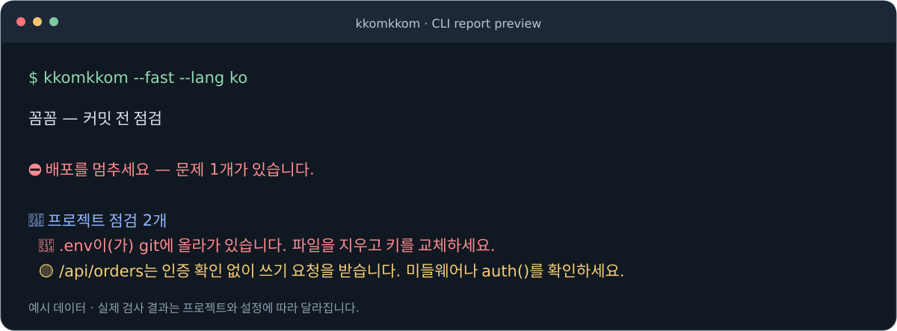

<div align="center">

# 🐯 꼼꼼 <sub>kkomkkom</sub>

**Next.js 앱의 인증·비밀정보·페이지 오류·JS 크기를 배포 전에 점검하는 CLI · MCP 도구.**

로컬에서 실행하고, 확인할 근거를 받으세요.

[](https://github.com/hodoi-ing/kkomkkom/actions/workflows/test.yml)
[](package.json)
[](LICENSE)

[빠른 시작](#빠른-시작) · [에이전트 연결](#에이전트-연결-mcp) · [검사 항목](#무엇을-검사하나요) · [지원·검증 상태](#지원검증-상태) · [English](#english)

</div>

<!-- DEMO_VIDEO: 실제 영상이 확보되면 아래 결과 이미지 앞에 GitHub 첨부 영상 URL을 삽입합니다. 편집 기준: docs/demo.md -->



<p align="center"><sub>현재 보고서 렌더러에 고정된 예시 데이터를 넣어 생성한 화면입니다. 실제 앱 검사 녹화는 아닙니다.</sub></p>

**개발 중 · npm 미공개.** 현재는 저장소에 접근할 수 있는 사용자가 소스에서 빌드해 사용합니다. 검사 결과는 검토할 신호이며, 취약점이나 배포 안전 전체를 보증하지 않습니다.

## 빠른 시작

Node.js 20 이상과 의존성이 설치된 Next.js 프로젝트가 필요합니다. 아래 명령은 bash 환경(예: WSL Ubuntu) 기준입니다.

**1. 꼼꼼을 받아 빌드합니다.**

```bash
git clone https://github.com/hodoi-ing/kkomkkom.git
cd kkomkkom
npm ci
npm run build
```

**2. 검사할 Next.js 프로젝트 폴더에서 실행합니다.** 두 경로를 자신의 실제 경로로 바꾸세요.

```bash
cd /absolute/path/to/your-next-app
node /absolute/path/to/kkomkkom/dist/cli.js --fast --lang ko
```

`--fast`는 새 빌드와 JS 크기 측정을 생략합니다. HTTP·소스 검사는 실행하며, 필요한 경우 개발 서버를 시작합니다. 빌드까지 검사하려면 `--fast`를 빼세요. 빌드가 성공하면 기준선 파일도 자동으로 저장됩니다.

<details>
<summary>짧은 kkomkkom 명령으로 실행하기</summary>

빌드한 꼼꼼 저장소에서 `npm link`를 실행하면 이 컴퓨터에 CLI 명령이 연결됩니다. 이후 검사할 앱 폴더에서 실행하세요.

```bash
# 꼼꼼 저장소에서
npm link

# 검사할 Next.js 프로젝트에서
kkomkkom --fast --lang ko
```

현재 안내에서는 npm에 공개되지 않은 패키지를 `npx`로 받지 않습니다.

</details>

## 에이전트 연결 (MCP)

직접 명령을 실행하는 대신 에이전트가 같은 검사 엔진을 호출할 수 있습니다. 로컬에서 빌드한 stdio MCP 서버를 사용합니다.

아래는 `mcpServers` 형식을 사용하는 클라이언트의 설정 예시입니다. `args`의 파일 경로를 바꾸세요. 클라이언트마다 설정 위치와 형식이 다를 수 있습니다.

```json
{
  "mcpServers": {
    "kkomkkom": {
      "command": "node",
      "args": ["/absolute/path/to/kkomkkom/dist/mcp.js"]
    }
  }
}
```

도구 이름은 `kkomkkom`입니다. 호출 인자 예시:

```json
{
  "projectPath": "/absolute/path/to/your-next-app",
  "fast": true,
  "lang": "ko"
}
```

`strict`, `reuse`도 받을 수 있습니다. **OpenCode·Codex 등 에이전트별 실제 설치·연결·호출 검증은 보류 중**입니다. MCP 서버 제공과 각 에이전트의 호환성 검증 완료를 구분합니다. [재개 체크리스트 →](https://github.com/hodoi-ing/kkomkkom/issues/2)

## 무엇을 검사하나요?

| 검사 | 제공하는 근거 | 해석할 때 확인할 점 |
|---|---|---|
| **API 인증** | 쿠키·인증 헤더 없는 GET 응답과 소스의 인증 신호 | 공개 API의 200 응답만으로 취약점을 확정하지 않습니다. 간접 인증·미들웨어를 추가 확인하세요. |
| **비밀정보** | git에 추적된 루트 `.env*`, 하드코딩 키 패턴, 의심스러운 `NEXT_PUBLIC_` 이름 | 예제값·공개 설정은 구분해야 하며, 탐지·마스킹 범위에 한계가 있습니다. |
| **페이지 오류** | 페이지 GET에서 관찰한 오류·타임아웃 | 브라우저 렌더링·클릭·로그인 흐름을 검증하는 검사는 아닙니다. |
| **쓰기 API** | POST·PUT·PATCH·DELETE 소스의 인증 신호 | 쓰기 요청은 보내지 않습니다. 파일 단위 분석이라 메서드별 인증을 잘못 판단할 수 있습니다. |
| **JS 크기 증가** | 빌드 산출물·출력에서 구한 라우트별 크기와 이전 기준선 비교 | 기본 경고 조건은 증가율 15% 이상 **그리고** 30,000바이트 이상. 실제 네트워크 전송량·화면 속도 측정은 아닙니다. |

### 결과를 보고 무엇을 하나요?

1. 보고서에 나온 경로·파일과 관찰 내용을 확인합니다.
2. 공개하도록 만든 API인지, 인증이나 미들웨어가 실제로 적용되는지 확인합니다.
3. 필요한 수정을 한 뒤 같은 조건으로 다시 검사합니다.

보고서의 `exposed`나 “뚫린 문” 표현도 현재 탐지 규칙의 판정입니다. 실제 권한 우회 여부는 별도 확인해야 합니다. [정확도·오류 처리 개선 항목 →](https://github.com/hodoi-ing/kkomkkom/issues/1)

## 자주 쓰는 명령

아래는 `npm link`로 명령을 연결한 경우입니다. 연결하지 않았다면 `kkomkkom`을 `node /absolute/path/to/kkomkkom/dist/cli.js`로 바꾸세요.

```bash
kkomkkom --fast --lang ko   # 새 빌드 없이 검사
kkomkkom --lang ko          # 빌드·JS 크기 비교 포함
kkomkkom --json             # JSON 보고서
kkomkkom --strict           # 경고도 종료 코드 1로 처리
kkomkkom --reuse --port 3100 # 실행 중인 Next 서버 사용
kkomkkom --explain          # 설치된 AI CLI로 추가 설명 요청
```

`--reuse`는 같은 프로젝트의 서버인지 확인하지 않습니다. `--explain`은 설치된 AI CLI를 사용하며, 해당 CLI 설정에 따라 외부 모델로 데이터가 전달될 수 있습니다.

<details>
<summary>전체 옵션과 종료 코드</summary>

| 옵션 | 동작 |
|---|---|
| `--fast` | 새 빌드·새 JS 크기 측정을 생략. 나머지 검사는 실행 |
| `--json` | `diff`, `extra`, `exitCode` 등을 JSON으로 출력 |
| `--strict` | 현재 warning으로 분류된 항목도 종료 코드 1로 처리 |
| `--port 3100` | 개발 서버 포트 지정 |
| `--reuse` | 지정 포트에서 실행 중인 Next 서버 재사용 |
| `--lang ko` | 보고서 언어: `en`, `ko`, `ja`, `zh`, `es` |
| `--explain` | `claude`, `codex`, `gemini` 순으로 설치된 AI CLI 탐색 |
| `--explain-with codex` | 설명에 사용할 AI CLI 우선 지정 (`--explain`과 함께 사용) |
| `--update` | `--fast` 결과의 API 판정으로 기준선 갱신. 기존 페이지 크기는 유지 |
| `--help`, `--version` | 사용법·버전 표시 |

언어 적용 순서: `--lang` → `KKOMKKOM_LANG` → `LC_ALL` → `LANG`.

| 종료 코드 | 현재 동작 |
|---|---|
| `0` | 현재 규칙상 실행을 막는 결과가 없음. 기본 모드의 warning이나 일부 미검증 결과도 포함될 수 있음 |
| `1` | API `exposed`, critical 항목, 빌드 실패 또는 `--strict`의 warning |
| `2` | 프로젝트·포트·설정 오류 등으로 검사를 시작하거나 완료하지 못함 |

`unknown`·생략된 검사까지 `--strict`가 실패로 처리하는 것은 아닙니다. 종료 코드 0과 “배포해도 좋습니다” 문구를 전체 검증 완료로 해석하지 마세요. 관련 동작은 [#1](https://github.com/hodoi-ing/kkomkkom/issues/1)에서 추적합니다.

</details>

<details>
<summary>설정과 기준선</summary>

검사할 프로젝트 루트에 `kkomkkom.config.json`을 둡니다.

```json
{
  "ignoreRoutes": ["/api/health", "/api/webhooks/*"],
  "sampleParams": { "/api/orders/[id]": { "id": "1" } },
  "port": 3100,
  "thresholds": { "jsPercent": 15, "jsBytes": 30000 }
}
```

| 설정 | 용도 |
|---|---|
| `ignoreRoutes` | 검사에서 제외할 경로. 공개 API인지 확인한 뒤 지정 |
| `sampleParams` | 동적 라우트에 넣을 테스트 값. 값이 없으면 해당 동적 API의 HTTP 검사는 생략 |
| `port` | 개발 서버 포트 |
| `thresholds` | JS 크기 증가의 경고 기준. 두 조건을 모두 충족해야 경고 |

기준선은 `.kkomkkom/baseline.json`에 저장됩니다. 예시 구조:

```json
{
  "version": 1,
  "createdAt": "2026-10-22T00:00:00.000Z",
  "routes": { "/api/secret": { "verdict": "locked" } },
  "pages": { "/checkout": { "firstLoadJs": 180000 } }
}
```

일반 실행은 빌드 성공 시 기준선을 자동 갱신합니다. 크기 증가 경고가 있어도 저장될 수 있으므로, 팀 기준으로 공유하기 전에 변경 내용을 검토하세요. `--fast --update`는 API 판정만 갱신하고 기존 페이지 크기를 유지합니다.

</details>

<details>
<summary>CI에서 실행하기</summary>

현재는 npm 배포판 대신 빌드한 로컬 CLI를 사용합니다. 다음은 워크플로의 **단계 예시**이며, 두 저장소 체크아웃·의존성 설치·꼼꼼 빌드를 먼저 구성해야 합니다. 두 경로를 러너의 실제 경로로 바꾸세요.

```yaml
- name: Run kkomkkom
  working-directory: /absolute/path/to/your-next-app
  run: node /absolute/path/to/kkomkkom/dist/cli.js --fast --strict --lang ko
```

비공개 저장소를 가져오는 접근 권한도 필요합니다. `--fast`에서는 새 빌드·JS 크기를 검증하지 않으며, 일부 미검증 결과는 현재 종료 코드에 반영되지 않습니다.

</details>

## 실행 범위와 데이터 처리

- HTTP 검사는 `127.0.0.1`에 **GET만** 보내며 쿠키·인증 헤더를 넣지 않습니다. GET 핸들러에 부수효과가 있는 앱은 개발용 데이터로 검사하세요.
- 직접 시작한 개발 서버만 종료합니다. 현재 서버 시작 코드는 localhost 전용 바인딩을 명시하지 않습니다. 네트워크 바인딩 개선은 [#1](https://github.com/hodoi-ing/kkomkkom/issues/1)에 기록되어 있습니다.
- 소스·설정을 자동 수정하는 기능은 없습니다. 개발 서버·빌드가 생성물을 만들고, 기준선 저장·잘못된 기준선의 `.bak` 이동이 발생할 수 있습니다.
- 보고서·JSON·AI 설명용 프롬프트·빌드 오류 로그에 탐지 범위 내 비밀값을 `[redacted]`로 가립니다. 모든 비밀값의 제거를 보장하지 않습니다.
- `--explain`은 선택 기능입니다. 기본 검사는 AI 계정 없이 실행되지만, Next 도구 실행과 의존성 준비 과정에는 별도 설치·네트워크 사용이 필요할 수 있습니다.

## 지원·검증 상태

| 항목 | 현재 상태 |
|---|---|
| 프레임워크 | Next.js 대상. 다른 프레임워크 지원은 제공하지 않음 |
| 실행 방식 | CLI와 로컬 stdio MCP 서버 제공 |
| 자동 검증 구성 | GitHub Actions에 Node 20·22·24 단위 테스트와 실제 Next fixture e2e 구성. 실행 결과는 상단 Tests 배지에서 확인 |
| 에이전트별 검증 | **보류**. OpenCode·Codex 등 개별 클라이언트 호환성 완료를 보장하지 않음 |
| 배포 | npm 미공개. 저장소 접근 권한과 로컬 빌드 필요 |
| 추가 앱 보호 | 소스맵·불필요한 배포 파일·클라이언트 번들 노출 점검, 선택형 보호 적용은 **로드맵** |

### 현재 한계

- 인증·쓰기 API 판정은 가벼운 소스 분석이라 문자열·간접 호출·메서드별 인증을 잘못 해석할 수 있습니다.
- 비밀정보 검사는 루트 `.env*`와 주요 소스 폴더 중심이며, 하위 `.env`와 모든 셸 환경변수를 다루지 않습니다. `NEXT_PUBLIC_`는 이름 기반 신호입니다.
- 개발 서버 HTTP 결과는 production 배포 검증과 다릅니다. 페이지 타임아웃·검사 생략·지원하지 않는 빌드 형식도 확인해야 합니다.
- JS 크기는 압축 전 파일 크기 등의 비교값입니다. 빌드 출력 단위·누락 청크 처리에 알려진 개선 항목이 있습니다.

[정확도·오류 처리 개선 #1](https://github.com/hodoi-ing/kkomkkom/issues/1) · [제품 로드맵·검증 재개 체크리스트 #2](https://github.com/hodoi-ing/kkomkkom/issues/2)

## 개발과 참여

```bash
npm ci
npm test          # 빌드 + 단위 테스트
npm run verify    # 빌드 + 단위 테스트 + 실제 Next fixture e2e
```

오탐·누락을 발견했다면 실제 비밀값을 제거한 최소 예제와 명령, 예상 결과, 실제 결과를 [이슈](https://github.com/hodoi-ing/kkomkkom/issues)에 남겨주세요.

[데모 영상 편집·삽입 가이드](docs/demo.md) · [MIT 라이선스](LICENSE)

<a id="english"></a>
<details>
<summary><b>English</b></summary>

**kkomkkom** is a local CLI and stdio MCP tool for checking Next.js apps before a commit or deployment. It combines unauthenticated HTTP GET probes, source-based auth and secret signals, page error checks, and JS size comparisons against a saved baseline.

The package is not published to npm. Clone an accessible copy of this repository, run `npm ci` and `npm run build`, then run `node /absolute/path/to/kkomkkom/dist/cli.js --fast` from your Next.js app. Replace the absolute path with your local checkout. Remove `--fast` to build and measure JS size; a successful build automatically updates the baseline.

For MCP, launch `node /absolute/path/to/kkomkkom/dist/mcp.js`. The tool is named `kkomkkom`; pass the app's absolute `projectPath`. Individual agent connection tests are deferred, not completed.

The preview above uses sample data, not a recorded app scan. Findings require review: a 200 response does not by itself prove an auth bypass, and exit code 0 is not a security guarantee. Sources and settings are not automatically fixed; dev/build artifacts and baseline files can change. Redaction has limits. Optional AI explanations may send data to the configured model provider.

See [known issues](https://github.com/hodoi-ing/kkomkkom/issues/1) and the [roadmap](https://github.com/hodoi-ing/kkomkkom/issues/2). Additional exposure checks and protection features are planned, not implemented. MIT licensed.

</details>
